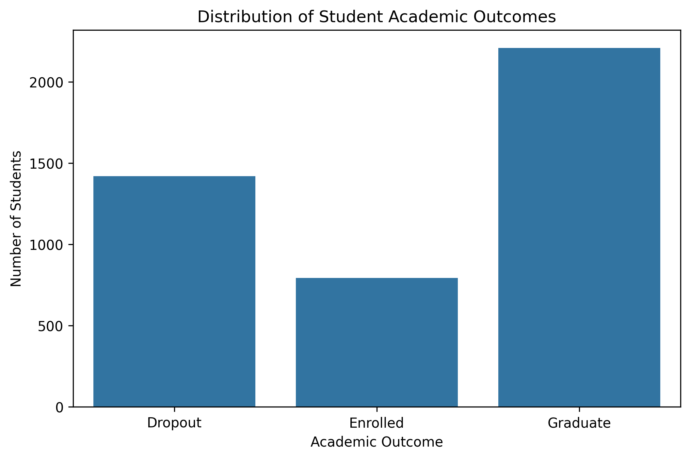
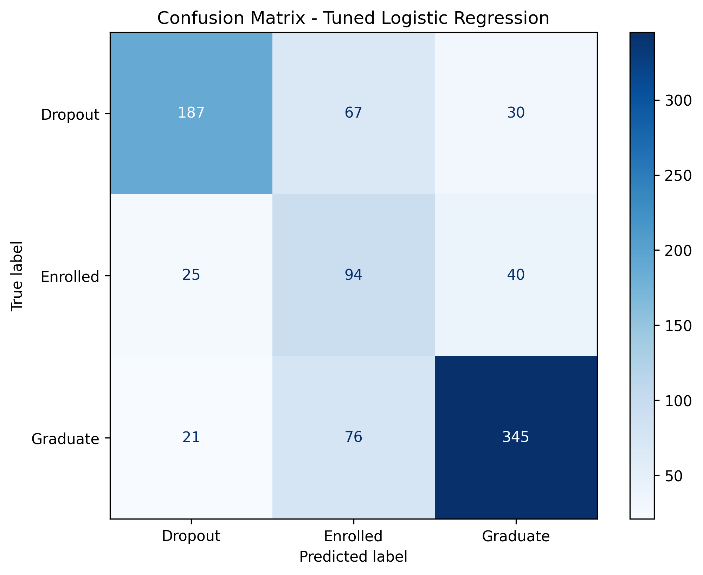
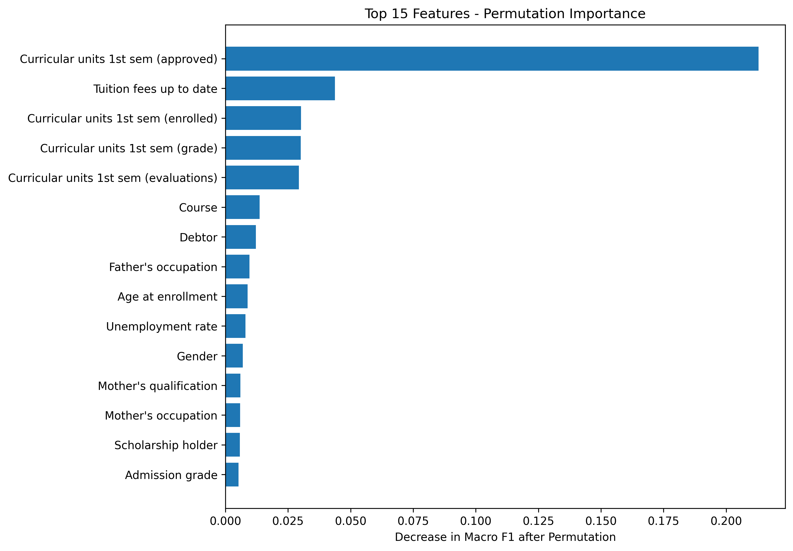
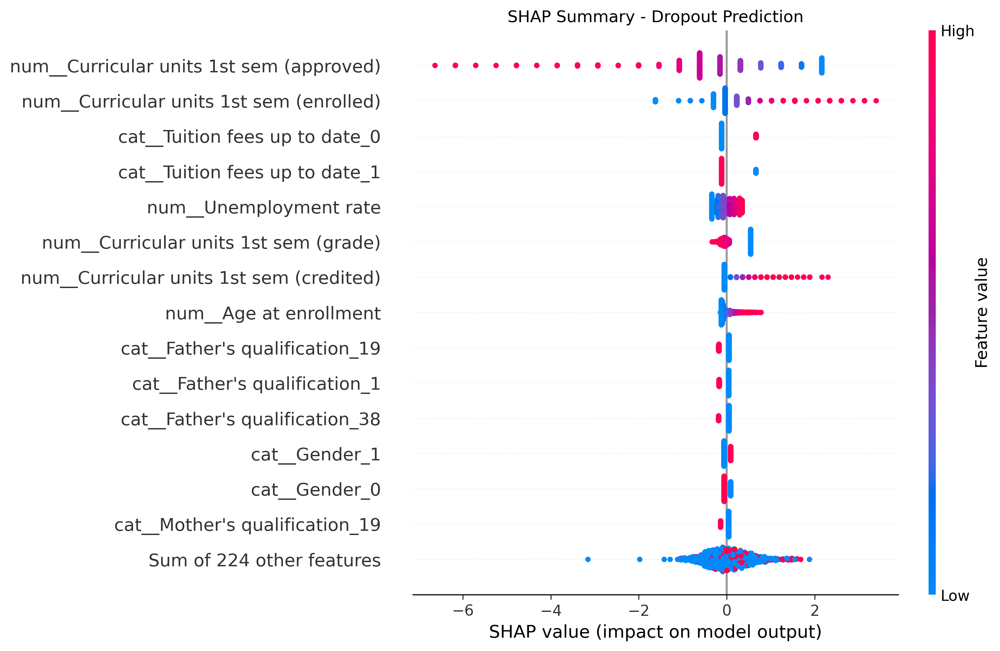

# Student Dropout Prediction Using Machine Learning

A machine learning project that predicts students' academic outcomes using demographic, socioeconomic, and first-semester academic data. The project compares classification models and applies explainable AI techniques to interpret model predictions.

## Project Overview

Student dropout is an important challenge in higher education. Identifying students who may be at risk of dropping out can help institutions better understand academic performance patterns and explore potential support strategies.

This project uses machine learning to predict one of three student outcomes:

- **Dropout**
- **Enrolled**
- **Graduate**

The main objective is to build and evaluate classification models and investigate which features are most influential in their predictions.

## Dataset

The project uses the [Predict Students' Dropout and Academic Success dataset](https://archive.ics.uci.edu/dataset/697/predict+students+dropout+and+academic+success) from the UCI Machine Learning Repository.

- 4,424 student records
- 37 original columns, including the target variable
- Three target classes: Dropout, Enrolled, and Graduate

To reduce information leakage, six second-semester academic variables were excluded from the predictive feature set. The analysis focuses on the remaining 30 input features.

## Project Workflow

1. **Data Understanding and Cleaning** — explored the dataset, checked missing values and duplicates, and examined feature distributions.
2. **Exploratory Data Analysis (EDA)** — investigated academic and socioeconomic patterns, including scholarship status and tuition payment.
3. **Data Preprocessing** — separated numerical and categorical variables, applied standard scaling and one-hot encoding.
4. **Model Development** — trained Logistic Regression and Random Forest classifiers.
5. **Model Evaluation** — assessed performance using accuracy, precision, recall, and macro F1-score.
6. **Hyperparameter Tuning** — used cross-validation and parameter search to improve model performance.
7. **Model Explainability** — applied permutation feature importance and SHAP.
8. **Fairness Analysis** — compared model performance across gender-coded subgroups.

## Models and Results

The models were evaluated on a held-out test set containing 20% of the data.

| Model | Accuracy | Macro F1-score |
|---|---:|---:|
| Tuned Logistic Regression | 0.707 | 0.668 |
| Tuned Random Forest | 0.720 | 0.661 |

Logistic Regression achieved a slightly higher macro F1-score, while Random Forest achieved higher overall accuracy.

Logistic Regression was selected as the primary model for further interpretation because of its slightly higher macro F1-score and comparatively straightforward structure.

## Project Visualizations

### Student Outcome Distribution

### Confusion Matrix — Logistic Regression

### Permutation Feature Importance

### SHAP Summary — Dropout Class

## Explainable AI

Two approaches were used to investigate feature importance:

- **Permutation Feature Importance** — measured how model performance changed when individual features were shuffled.
- **SHAP (SHapley Additive exPlanations)** — examined how features contributed to individual predictions and overall model outputs.

The number of approved curricular units in the first semester was among the most influential features. Other relevant features included tuition fee status, enrolled curricular units, academic grades, and evaluation counts.

These findings describe model associations and should not be interpreted as evidence of causation.

## Fairness Analysis

Model performance was also examined across gender-coded subgroups.

The results showed differences in classification performance between the groups. This is an initial subgroup performance analysis, not a comprehensive fairness audit.

Further evaluation using additional fairness metrics and careful validation of subgroup definitions would be necessary.

## Key Limitations

- The dataset comes from a specific higher education institution, so results may not generalize to other universities.
- The target represents final academic outcomes; predictions are based on a restricted set of available features.
- Model predictions do not establish causal relationships.
- The analysis does not demonstrate that interventions based on these predictions improve student outcomes.
- Fairness analysis is preliminary and requires further investigation.

## Technologies

- Python
- Google Colab
- Pandas
- NumPy
- Matplotlib
- Seaborn
- Scikit-learn
- SHAP
- Git and GitHub

## Repository Contents

`student_dropout_prediction.ipynb` — Jupyter Notebook containing the complete analysis, preprocessing, model development, evaluation, and explainability workflow.

## How to Run

1. Open the notebook in Google Colab:

   [Open in Google Colab](https://colab.research.google.com/github/symbat-omirali/student-dropout-prediction/blob/main/student_dropout_prediction.ipynb)

2. Run all cells from top to bottom using
   Runtime > Run all.

3. The notebook installs the required Colab dependencies
   and loads the dataset from the UCI Repository.

4. Review the model evaluation, feature importance,
   SHAP explanations, and subgroup analysis.

The complete dependency list is available in requirements.txt.

## Author

Created as a machine learning portfolio project focused on student academic outcome prediction and explainable AI.
